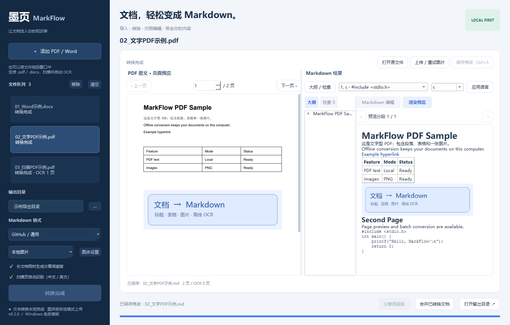

# 墨页 MarkFlow

本地 PDF、Word、Excel、PPT、HTML、LaTeX、Markdown、JSON 和图片互转桌面工具：离线中英文 OCR、标题与代码整理、图片导出、图床接口、对照编辑和长文档分章阅读。

**Windows 10 / 11 x64 · 中文界面 · Python 3.12 · MIT**

[下载 Windows 免安装版](https://github.com/Melderyk/MarkFlow/releases/latest) · [更新记录](CHANGELOG.md) · [贡献指南](CONTRIBUTING.md) · [隐私与安全](SECURITY.md)



界面示例使用项目生成的测试文件，输出目录路径已隐去。

English: MarkFlow is a Windows desktop PDF/DOCX-to-Markdown converter with local Chinese/English OCR, code blocks, an outline, image hosting adapters and chapter exports. Text conversion runs locally. Images are uploaded only when you choose hosting or explicitly start an upload. Download the portable build from Releases; source setup is below.

当前版本 **0.3.2**，修复大于 64 MB 的 PDF 无法转换的问题，PDF 输入上限调整为 **256 MB**，并显式释放逐页图片资源。保留多格式转换、图片嵌入、图床、大纲和大表格分段预览功能，原有依赖版本保持锁定。文档在本机处理；Markdown 仍作为可编辑工作文件保存。

## 格式转换

选择输入文件和“导出格式”后开始批量转换。每个输入始终保存 UTF-8 Markdown 工作文件；选中的 Word、Excel、PPT、HTML、PDF、LaTeX 或 JSON 格式另存为同名文件。选择 Markdown 时不创建第二个文件。

“保存修改”仍只保存 Markdown 和分章；编辑后点击“导出当前内容”重新生成所选格式。转换及重新导出均在独立子进程执行，每份文件结束后退出进程，格式库不会常驻界面进程。停止请求先协作取消；3 秒后仍未响应时结束转换进程及其 Pandoc 子进程。

**PDF 输入上限为 256 MB，其他输入格式为 64 MB**（容量按 1024² 字节计算）。PDF 按页分析，单页渲染最长边不超过 4500 像素，逐页关闭图片；转换在独立进程执行，结束后退出进程。文件体积并不等于峰值内存，复杂版面、大量图片和 OCR 仍可能增加耗时与内存，超过上限时请拆分。

DOCX / XLSX / PPTX 在解析前检查解压总量，限制为 256 MB；工作簿合计最多 50 万单元格、每表 10 万行 / 2048 列、文本 1600 万字符；OCR 图片每帧最多 2400 万像素、最多 200 帧。JSON 文档表格也检查补齐后的单元格数。XLSX 使用只读流式解析并关闭文件句柄。图片嵌入仍有单独的容量限制，PDF 上限增大不改变 Typora 或嵌入模式的兼容性限制。

### Word 表格往返转换

检测到横向合并、纵向合并或嵌套表格时，使用 HTML 表格保留结构，避免合并标题重复填入多列。普通无合并表格仍使用 Markdown 表格。

复杂 Word 表格会在同名 `.assets` 文件夹中保存原 DOCX 排版参考与文字位置，用于恢复页边距、列宽、行高、字体、页眉等信息。**Markdown 与 `.assets` 必须一起保留或移动**；其中包含原 Word 完整内容，请按原文档同样的隐私要求处理。未编辑时导出的 Word 与原文件字节一致；在保留表格和文字标记的情况下修改单元格文字、填写空单元格时，会沿用原排版。改变表格合并、删除文字标记或改动未映射的正文结构，会明确提示无法安全恢复，避免悄悄生成错乱的文件。

单独的 Markdown 不具备 Word 页边距、行高等全部排版信息。未携带排版参考的 HTML 合并表格仍可常规导出合并结构，但不会还原原 Word 的全部外观。0.3.0 之前已经丢失合并信息的文件需要从原 Word 重新转换。

| 输入 | 提取行为 |
|---|---|
| PDF / DOCX | 保留现有正文、标题、表格、图片和 OCR 转换 |
| HTML | 转换语义正文和本地位图；移除脚本、样式和远程资源，不执行 HTML |
| XLSX / XLS / CSV / TSV | 按工作表输出表格；`.xls` 只读支持；公式以文本保留，不计算 |
| PPTX | 按幻灯片提取标题、文本、表格、图片和备注；不保留动画及原始版式；旧 `.ppt` 请另存为 `.pptx` |
| LaTeX | 转换标题、列表、表格和数学公式；不执行宏包，不读取外部 `\\input` 文件 |
| PNG / JPEG / WebP / BMP / TIFF | 本地中英文 OCR，原图按所选图片模式保存或嵌入，供核对 |
| Markdown | 规范化标题、代码、表格和本地图片；远程图片不会下载 |
| JSON | 接受 MarkFlow 工作簿 / 文档结构 JSON，或 `{"markdown":"..."}` |

导出使用随应用打包的 Pandoc、python-docx、openpyxl、python-pptx 和 Qt PDF 打印引擎。HTML 仅导出脱离脚本的静态文件。PDF 为排版导出，不会反向重建源 PDF 的原始分页、字体和矢量布局；LaTeX 转换也不保证从普通 PDF 或 OCR 中恢复数学公式。Excel 导出从 Markdown 中识别表格；需要完整保留工作表名称、合并区域和公式文本时，可将 MarkFlow workbook JSON 导回 XLSX。旧版 `.doc` / `.ppt` 不属于 Office Open XML 格式。

## 使用免安装版

1. 将 `MarkFlow-v0.3.2-windows-x64.zip` **完整解压**到一个可写目录。
2. 双击 `MarkFlow.exe`。程序需要同目录的 `_internal`，不要只移动 EXE。
3. 点击“添加文件”，或把支持的文件拖入队列、编辑区、原文预览、大纲或窗口空白处。
4. 选择输出目录、Markdown 格式，点击“开始转换”。
5. 对照原文检查结果。在右侧编辑 Markdown，点击“保存修改”或按 Ctrl+S。
6. 需要一个总文件时，点击“合并已转换文档”。合并顺序为队列中的添加顺序。

适用于 Windows 10 / 11 x64。运行时无需安装 Python、Word 或 OCR 服务。OCR 模型随程序提供，使用 CPU 在本机运行。本地图片模式不联网；选择图床模式或点击“上传 / 重试图片”会向所配置的服务上传图片。不发送 PDF / Word 原文件或单独发送 Markdown 文本，不调用云端 AI。扫描代码的原页核对图包含该页内容，也属于导出图片，选择图床时会一同上传。

## 图床与本地图片

在左侧选择“本地图片”或“图床链接＋本地备份”，再开始转换。转换后也可点击“上传 / 重试图片”，上传当前文档中的本地图片并保存当前编辑内容。

也可选择 **“嵌入图片（单文件 MD）”**，将位图以 Base64 Data URL 写进 Markdown，不上传图片；普通文档不会另建 `.assets` 图片文件夹，也不生成分章副本，移动一个 `.md` 即可携带图片。软件内支持图片预览。单张图片最多 8 MB、图片合计 16 MB、嵌入后的 Markdown 最多 32 MB，超限请选择本地图片或拆分文档。

Base64 会增大文件，部分 Markdown 阅读器或网站可能过滤嵌入图片；对外分享前请在目标阅读器检查。复杂 Word 的原排版恢复仍需 `.assets` 中的原 DOCX 和映射，嵌入图片不能替代这些参考文件。导出 LaTeX 时也会生成编译所需的图片文件。

**Typora 文件大小提醒：**维护者在 [官方问题 #1961](https://github.com/typora/typora-issues/issues/1961#issuecomment-453126121) 中明确说明过将限制调整为 **2 MB**，用于避免大文件解析、渲染导致无响应。这是官方历史说明，不保证所有当前版本的精确阈值相同；[问题 #3909](https://github.com/typora/typora-issues/issues/3909) 也讨论了嵌入图片导致文档超过限制。软件在嵌入结果超过 2 MiB 时显示兼容性警告，不阻止转换；MarkFlow 的 32 MB 转换上限不代表 Typora 能打开该大小。以本机 1.14.15 验收时，约 18 MB 的嵌入文档被 Typora 拒绝。主要用 Typora 阅读长文档时，建议选择“本地图片”或“图床链接＋本地备份”；需要离线携带时将 MD 与 `.assets` 一起打包，或启用分章阅读。单文件图片嵌入不保证兼容 Typora 的大文件限制。

| 接口模板 | 配置方式 |
|---|---|
| PicGo / PicList 本机服务 | 先在 PicGo / PicList 中配置存储，再开启本机上传服务；默认地址 `http://127.0.0.1:36677/upload`，使用已选中的图床 |
| Lsky Pro / 兰空 | 填写站点的完整上传 API 地址，通常为 `/api/v1/upload`，以及 Token |
| EasyImages / 简单图床 | 填写站点的上传 API 地址，通常为 `/api/index.php`，密钥通过 `token` 表单字段提交 |
| S.EE | 提供上传接口模板，填写 API Token；不同服务版本可调整返回链接路径 |
| SM.MS 兼容接口 | 面向仍提供该兼容接口的站点；服务可用性需实际测试 |
| 自定义 HTTP 接口 | 支持 multipart 文件上传、鉴权请求头或 token 表单字段、额外表单字段以及 JSON 返回链接路径 |

接口字段均可修改，`data.url`、`data.links.url`、`result.0` 表示从响应 JSON 中读取图片网址。先点击“上传测试图片”确认配置；这会实际上传一张 16×16 测试图片。PicGo 可通过其图床和插件配置连接多种存储，MarkFlow 不直接管理这些云厂商的账号。

上传成功后替换 Markdown 图片链接，失败的图片保留本地链接并显示提示；网络或服务临时错误会自动重试。相同文件和同一配置命中本地缓存时复用链接。`.images.json` 记录本地图片与远程网址的对应关系，`.assets` 始终作为本地备份。软件内预览优先使用本地副本。密钥可选择只在当前会话使用，或由 Windows DPAPI 加密保存在本机；源码和发行 ZIP 不包含个人配置、密钥或上传缓存。

## 长文档阅读与核对

- **分章阅读版**：默认勾选。正文至少 5 万字符且包含两个以上一级标题时，在保留完整 `.md` 的同时生成 `.chapters` 文件夹。打开其中的 `目录.md`，按章阅读；章末包含上一章、下一章和目录链接。保存编辑时同步已生成的章节。
- **软件内预览**：长文档按围栏代码边界安全分段，大表格按行分段并重复表头，使用上／下一段浏览；点击大纲可定位对应预览分段。相同内容不重复排版，预览图片按窗口缩放，导出文件保留完整内容。
- **可折叠大纲**：位于 Markdown 结果旁，点击箭头折叠，点击标题定位；“大纲 / 检查”按钮可隐藏导航以增大编辑空间。
- **手动代码语言**：选择代码块，或把光标放入代码块，选择语言后点击“应用语言”，再保存；正文不变，支持撤销。
- **质量提示**：在“检查”页查看未闭合代码围栏、疑似语言标签、标题跳级、丢失的本地图片与转换警告。OCR 警告带有页码时可跳转 PDF 原页。提示覆盖可检测的问题，不保证发现全部 OCR 错字。
- **拖拽导入**：可以把所有受支持文件拖到队列、编辑区、原文预览、大纲、按钮或窗口空白处，不会把文件路径插入正文。转换中不接收新文件。请正常启动程序；Windows 会限制不同权限级别程序之间的拖拽。

长文档中的代码高亮、图片解码和排版都可能影响阅读器流畅度。分章可降低单次打开的文档规模；图床改变图片地址，仍需解码图片，不能保证消除 Typora 卡顿。尚未测量 Typora 滚动帧率。

## 包含的功能

| 功能 | 实现 |
|---|---|
| DOCX | 提取标题、段落、基础强调、列表、超链接、表格和内嵌图片 |
| 文字 PDF | 优先按 PDF 书签还原标题层级；没有书签时参考文档字体；提取正文、代码块、链接、简单表格和图片 |
| 扫描 PDF | 按页检测扫描内容，本地 OCR 识别中文和英文；支持文字页与扫描页混合的 PDF |
| 基础格式 | 标题、加粗、斜体、列表、链接；PDF 灰底等宽代码区保留换行和缩进，Word 支持 Code / Source Code / 代码样式 |
| 图片 | 本地 `.assets` 相对链接、图床链接＋本地备份，或 Base64 嵌入单文件 MD |
| 简单表格 | 生成 Markdown 表格，处理单元格中的竖线与换行 |
| 桌面操作 | 中文窗口，文件选择与拖拽导入，输出目录选择 |
| 批量 | 顺序转换、进度状态、失败原因、停止与重试；单个文件失败后继续处理后续文件 |
| 预览与编辑 | PDF 原页面分页预览；Word 内容预览；Markdown 编辑和渲染预览 |
| 输出 | UTF-8 `.md` 文件；本地图片模式配套资源目录，普通嵌入模式为单文件；同名文件自动增加编号 |
| 合并 | 合并成功转换的文件并生成目录，包含当前编辑内容 |
| 格式适配 | GitHub / 通用、Obsidian、Typora；通用模式使用锚点目录，Obsidian 使用标题链接，Typora 使用 `[TOC]` |
| 本地 | 转换和 OCR 无需网络；图床模式按配置上传图片 |
| Windows | x64 文件夹式免安装程序 |

三种输出格式的正文语法相同。本地图片使用标准相对链接，图床图片使用远程网址。合并文件中的本地图片引用各原文档的图片文件夹；分享或迁移本地模式文档时，请将相关 `.md` 与 `.assets` 目录一并带走。

Typora 的“大纲”会根据 `#` 至 `######` 标题显示层级。如果左侧大纲不能折叠，请在“偏好设置 → 文件 → 大纲”勾选“允许折叠和展开侧边栏的大纲视图”。完整单篇文档保留正文顺序；合并文件插入目录，分章阅读版另有独立章节目录。

PDF 中跨页连续的代码面板会衔接为一个代码块。代码标签按内容区分 `c`、`bash`、`asm`、`powershell`；例如 `gcc -c ...` 是编译命令，标记为 `bash`。运行输出、文件名和操作步骤保留 `text`。匹配不到正文的书签会显示在转换提示中。重复页眉页脚经抽样识别后从正文移除。

扫描页结合灰色背景、彩色文字、文字坐标和代码语法识别代码区域，估计缩进与空行。颜色只是辅助信号，不能单独确定语言。OCR 实测仍可能遗漏独立括号、混淆 `0/O` 或丢失空格；识别出代码时会附上原页 PNG 并提示核对。文字型 PDF 优先直接提取字符，无需 OCR。

## 适用范围与已知限制

- Word 预览展示内容结构，不复现 Word 的分页与打印版式。旧版 `.doc` 需要先另存为 `.docx`。
- PDF 有书签时用书签层级匹配正文；没有书签时使用字体与坐标推断，双栏、复杂排版和特殊字体可能需要人工整理。Markdown 标准最多支持六级标题。
- 代码识别主要面向可提取文字的等宽字体、浅色背景面板；扫描图片中的代码经过 OCR 后仍需核对。原 PDF 中本来空白或缺失的内容不会自动补写。
- 简单表格主要面向 DOCX 表格与文字 PDF 的清晰网格表格。扫描页 OCR 输出文字，不保证恢复表格结构。
- OCR 的准确度受清晰度、旋转和字体影响。金额、编号和专有名词请对照原文校对。
- PDF 图片导出针对内嵌位图；矢量图和独立绘图元素不作为图片导出。DOCX 的 EMF / WMF 会保留原文件，阅读器支持情况不同。
- 密码保护 PDF 会提示失败。Word 合并表格支持见上方“Word 表格往返转换”；公式、脚注、修订和文本框尚无专项转换支持。
- 软件未做 Windows 代码签名；正式发布前可另行配置签名证书。

## 源码开发

需要 Windows x64、Python 3.12。可先用 VS Code 打开 `MarkFlow.code-workspace`，再在此目录的终端中运行：

```powershell
py -3.12 -m venv .venv312
.\.venv312\Scripts\python.exe -m pip install -r requirements-dev.txt
.\.venv312\Scripts\python.exe main.py
```

`requirements-lock.txt` 记录本次验证所用的完整开发依赖版本，可用于重建相同环境。

本分支保持 `requirements.txt`、`requirements-dev.txt` 和 `requirements-lock.txt` 的 0.2.2 版本。先用 Python 3.12 的独立虚拟环境安装原锁定依赖，再按需安装扩展；约束文件会阻止扩展升级原有组件：

```powershell
.\.venv312\Scripts\python.exe -m pip install -r requirements-lock.txt
.\.venv312\Scripts\python.exe -m pip --proxy http://127.0.0.1:7900 install -r requirements-formats.txt
.\.venv312\Scripts\python.exe -m pip check
```

扩展包为 Pandoc（`pypandoc_binary` 自带可执行文件）、openpyxl、python-pptx、xlrd、BeautifulSoup 及其固定版本的附属依赖。未安装扩展时仍可使用原有 PDF / DOCX 转 Markdown。需要下载国际网络资源时可添加 `--proxy http://127.0.0.1:7900`。打包环境安装扩展后，PyInstaller 会携带 Pandoc；没有扩展的环境仍可构建原功能。

测试：

```powershell
$env:QT_QPA_PLATFORM = "offscreen"
.\.venv312\Scripts\python.exe -m pytest -q
```

生成测试样本与打包：

```powershell
.\.venv312\Scripts\python.exe tests\samples.py 示例文件
.\.venv312\Scripts\python.exe -m PyInstaller --noconfirm MarkFlow.spec
```

开发自检入口（会将转换结果、界面截图和 JSON 报告写入指定目录，并禁止 Python socket 联网）：

```powershell
.\dist\MarkFlow\MarkFlow.exe --self-test .\selfcheck
```

也可用自己的文件运行界面压力检查；文件在本地转换，结果留在指定目录，报告不记录输入路径或正文：

```powershell
.\dist\MarkFlow\MarkFlow.exe --self-test-stress .\stresscheck "C:\documents\sample.pdf"
```

检查完成后还应确认程序退出码为 0。正常运行时，若界面心跳超过 6 秒未响应，会在程序目录 `diagnostics/ui-watchdog.log` 记录 Python 线程堆栈，方便定位；日志不主动记录文档正文或图床密钥。

`markflow/core.py` 是独立转换核心，`markflow/pdf_layout.py` 负责 PDF 字符几何、书签与代码块，`markflow/code_languages.py` 负责语言判断，`markflow/ocr_layout.py` 负责扫描代码布局，`markflow/image_host.py` 负责图床适配，`markflow/markdown_tools.py` 负责导航检查和分章，`markflow/app.py` 是 PySide6 桌面界面。设置保存在程序目录的 `markflow-settings.json` 中，输出默认位于程序目录的“导出”文件夹。

依赖许可证见免安装目录中的 `THIRD_PARTY_LICENSES`。PySide6 / Qt 按其 LGPL 等许可证使用，保留动态链接库及第三方声明。


## 开源许可

项目原创代码、图标和生成示例采用 [MIT License](LICENSE)。第三方组件及 OCR 模型保留各自的许可证，详见 [NOTICE.md](NOTICE.md) 和 [THIRD_PARTY_LICENSES](THIRD_PARTY_LICENSES/INDEX.md)。MIT 授权不覆盖第三方组件。

发行 ZIP 包含第三方声明与 Qt LGPL 文本。Qt / PySide6 / Shiboken6 以动态库形式分发，未修改；可替换兼容动态库。请保留声明并遵循对应组件的许可证。

提交问题时请先使用项目自带示例复现。请勿在公开 Issue 中上传含个人、机密或无权分享内容的 PDF、Token 或配置文件。
